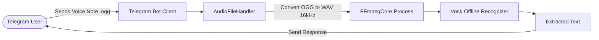

# 🎙️ VoiceTexterBot — High-Throughput Speech-to-Text Telegram Bot

[]()
[]()
[]()
[]()

> An offline, zero-cloud-cost Telegram bot that converts voice messages into text across multiple languages using Vosk acoustic models and FFmpeg.

---

## ⚡ Architectural Design



---

## 🛡️ Key Features

- **🔒 Offline & Private:** Speech-to-text processing occurs entirely locally on the server via Vosk models.
- **🌐 Multilingual Support:** Dynamic language detection and switching (Russian, English, French, Polish).
- **🧵 Concurrency & Isolation:** Thread-safe temporary file management using unique GUIDs to prevent race conditions.
- **🧼 Automatic Cleanup:** Guaranteed deletion of temporary audio files via lifecycle hooks.

---

## 🚀 Quickstart

```bash
git clone https://github.com/yandereye1/VoiceTexterBot.git
cd VoiceTexterBot/VoiceTexterBot1
dotnet run
```

> **Note:** Set your Telegram bot token in `appsettings.json` or pass it as an environment variable before starting.

---

## 👨‍💻 Author
GitHub: [@yandereye1](https://github.com/yandereye1)
